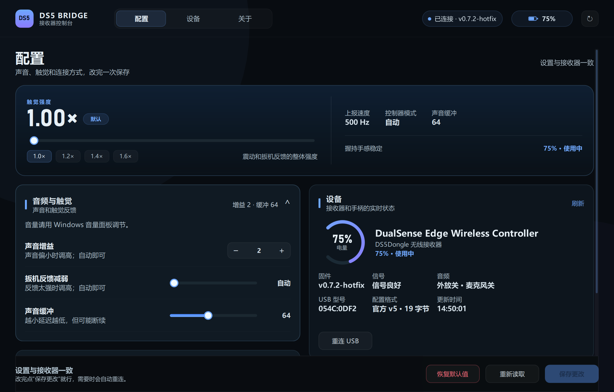
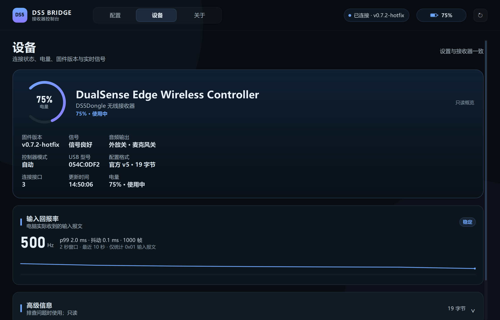

# DS5 Bridge Control / DSE Control

A Windows desktop console for the official **DS5Dongle** (Pico2W DualSense Bridge) and **DualSense Edge**, built with Python and PySide6/QML.  
官方 DS5Dongle + DualSense Edge 的 Windows 桌面控制台：HID 直连，不依赖网页或网络；包含 QML 主界面和旧版 QWidget 界面。



## 应用与入口

| 应用 | 入口 | 说明 |
| --- | --- | --- |
| **DS5 Bridge Control**（主界面） | `python ds5_qml_app.py` | Qt Quick / QML 控制台，面向官方 DS5Dongle |
| DS5 Bridge 旧版界面 | `python ds5_app.py` | QWidget 回退界面 |
| **DSE Control** | `python app.py` | DualSense Edge + 谷粒悟空2 接收器的旧版 QWidget 工具 |

## 功能

### DS5 Bridge Control

- **配置读写**：通过 HID Feature Report 读写官方 config v5（v0.7.2 / v0.7.2-hotfix，19 字节），改完一次保存。
- **设备状态**：连接状态、固件版本、电量、信号、音频输出、VID/PID、接口信息。
- **输入回报率**：独立句柄读取 `0x01` 输入报文，显示报告率、p99 间隔、p99−p50 抖动和最近 10 秒曲线。测量的是主机实际收到的 USB 报告，不是手柄内部蓝牙帧率。
- **托盘**：关闭窗口隐藏到托盘，后台保持连接；托盘菜单支持显示控制台、重新检测/读取接收器和退出。
- **自动重连**：轮询率、控制器模式、设备身份、USB 唤醒等影响 USB 识别的设置保存后自动重连。
- **无驱动**：只使用标准 HID Feature Report，不安装驱动，不写入 Sony 安装目录。



### DSE Control

- 电量、充电状态、左右马达震动测试、背键映射检测、接收器组合键引导、扬声器诊断和实时输入。
- 背键映射只做只读检测：接收器会把背键转换成普通按键后再上报，程序用“检测向导”还原当前生效的映射，不读取或写入接收器 flash。
- 接收器档位只能通过手柄组合键写入，主机侧没有写入接口；程序提供引导和本地记录，不伪造“一键写入成功”。

## 快速开始

要求：Windows 10/11 x64、Python 3.10+（实测 3.14）、官方 DS5Dongle（建议 v0.7.2 / v0.7.2-hotfix，见 [awalol/DS5Dongle](https://github.com/awalol/DS5Dongle)）。

```bat
git clone https://github.com/Winkless213/ds5-bridge-control.git
cd ds5-bridge-control

python -m venv .venv
.venv\Scripts\pip install -r requirements.txt

:: QML 主界面
.venv\Scripts\python ds5_qml_app.py
```

旧版 QWidget 界面：`.venv\Scripts\python ds5_app.py`  
DSE Control：`.venv\Scripts\python app.py`

当前仓库包含源码；预编译安装包见 [Releases](https://github.com/Winkless213/ds5-bridge-control/releases)。

## 安装

从 Releases 下载 `DS5-Bridge-Control-Setup-1.5.0.exe`。安装到当前用户目录，不需要管理员权限、Python 或额外运行库；安装程序会检查 64 位 Windows 10/11、Qt/VC 运行文件和安装后的启动自检。

安装包未做代码签名，Windows SmartScreen 可能提示；可选择“更多信息 → 仍要运行”。

## 打包

```bat
python -m PyInstaller "DS5 Bridge Control.spec" --noconfirm
```

输出：`dist\DS5 Bridge Control\DS5 Bridge Control.exe`（onedir，约 162 MB）。

生成安装包需要 Inno Setup 7：

```bat
ISCC.exe installer\DS5BridgeControl.iss
```

输出：`work\release\installer\DS5-Bridge-Control-Setup-1.5.0.exe`。

截图模式：

```bat
python ds5_qml_app.py --screenshot
```

截图生成到 `output/frontend-qa/`，该目录不纳入仓库。

## 兼容性与边界

- **只支持官方 19 字节 config v5**，不兼容 fork 的 30 字节布局。
- **不刷固件**：程序只读写接收器配置和标准 HID 报文，不写 flash、不安装驱动。
- **实测手柄**：DualSense Edge + 官方 DS5Dongle v0.7.2-hotfix；普通 DualSense 未做完整回归。
- **音频**：接收器实测只转发触觉声道，不转发扬声器声道；Windows 可能仍枚举音频端点。
- **回报率**：无线 500 Hz 稳定在约 2 ms，日常建议使用 500 Hz；实时档平均间隔更低，但 p99 抖动更大，只适合对比。真正有意义的更低延迟升级是有线 1000 Hz。
- **托盘**：使用 Windows 原生菜单；未做单实例和开机自启。
- **平台**：仅 Windows。

## 技术记录

- [接收器协议与逆向记录](docs/REVERSE_ENGINEERING.md)
- [真机、QML 与托盘验证](docs/TESTING.md)

## 项目结构

```
ds5_qml_app.py             DS5 Bridge QML 入口（主界面）
ds5_app.py                 DS5 Bridge 旧版 QWidget 入口
app.py                     DSE Control 入口
ds5_bridge/protocol.py     DS5Dongle HID 协议
ds5_bridge/service.py      后台 HID 任务、电池和回报率线程
ds5_bridge/qml_bridge.py   QML 视图模型
ds5_bridge/tray.py         系统托盘
ds5_bridge/qml/            QML 页面与组件
dse_panel/                 DSE Control 的协议、设备、映射和界面
tests/                     单元测试
tools/                     截图与冒烟脚本
installer/                 Inno Setup 安装脚本
docs/                      验证记录与逆向记录
```

## 开发

```bat
.venv\Scripts\pip install pytest
.venv\Scripts\python -m pytest tests -q
```

最近结果：`56 passed`。

## 许可证与免责声明

本项目采用 GNU General Public License v3.0，详见 [`LICENSE`](LICENSE)。Copyright (C) 2026 Winkless213 and contributors。

第三方依赖、传递依赖及参考项目的许可证见 [`THIRD_PARTY_NOTICES.md`](THIRD_PARTY_NOTICES.md)。

本项目与 Sony Interactive Entertainment 无关联。“PlayStation”“DualSense”“DualSense Edge”是 Sony Interactive Entertainment Inc. 的商标。仓库不包含 Sony 固件、PlayStation 系统软件、官方驱动或 DualSense/DualSense Edge 的专有二进制资源；接收器协议和逆向记录仅用于互操作性研究。
